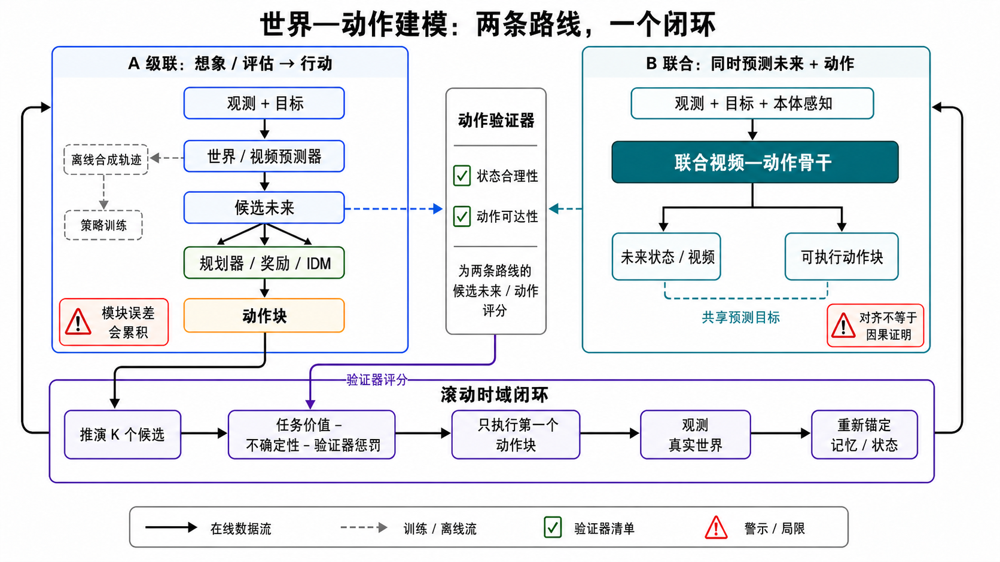

<a id="world-action-model"></a>

# 世界—动作模型（WAM）

介绍未来预测参与动作选择、执行反馈和重新规划的基本系统结构。

**前置知识：** 动作条件预测、世界模型。

**使用步骤：** 定义动作空间和任务目标 → 连接预测、规划与执行接口 → 在独立环境中验证决策收益。

World Action Model（WAM，世界—动作模型）关心的核心不是“能否生成一段看起来合理的视频”，而是更严格的问题：**系统能否把当前观测、候选动作与未来后果联系起来，并在真实反馈到来后修正下一步行动？**

如果视频生成回答“接下来可能看到什么”，WAM 还要回答“**如果我做 A 而不是 B，会发生什么；我应据此做哪一步；发现预测错了以后怎样重规划**”。这使它成为连接视频生成、世界模型、机器人控制与交互式环境的重要概念。

> 本章负责预测与行动的耦合、级联与联合架构及闭环设计。状态与动力学见[世界模型](world-models.md)，动作时间规格见[动作条件预测](tasks/action-conditioned-prediction.md)，可操控观测流见[交互式世界生成](tasks/interactive-world-generation.md)。

## 学习目标

读完本章后，你应能：

1. 用“动作是否进入未来预测、预测是否影响决策、决策是否接受反馈”三个问题判断一个系统是否接近 WAM；
2. 区分视频生成、视频预测、世界模型、动作条件预测、交互式世界生成与 WAM；
3. 说明观察、状态、动作、rollout、验证与重规划在闭环中的作用；
4. 理解动作条件视频、latent world model、游戏/具身模拟、视频基础模型和交互环境五类研究路线；
5. 设计不止评测画面质量、还能检验动作因果与闭环效用的实验。

## 1. 动作与未来预测示例

设想机器人面对一扇半开的门。它可以向左推、向右拉，或先后退观察门轴和把手。一个普通视频生成器可以生成“门被打开”的视觉片段；但要成为 WAM，系统至少要区分不同动作产生的后果：

- 向错误方向施力时，门可能卡住、反弹，或遮挡视野；
- 门轴、摩擦和障碍物使同一个动作并不总有同一种结果；
- 预测到碰撞或失败时，系统应改变动作，而不是继续渲染一个看似流畅的未来；
- 新的相机画面到来后，系统要用它校正自己的状态估计并再次规划。

因此，WAM 的价值不在于“想象得更漂亮”，而在于它能否让想象**参与决策并接受证伪**。

## 2. 基本概念

概念的统一定义见[世界模型基本概念](world-models.md#1)，概率与张量接口见[动作条件预测](tasks/action-conditioned-prediction.md#1)。本章用以下三个问题判断预测与行动是否实际耦合。

一个实用判据是连续问三个问题：

1. **动作进入模型了吗？** 若动作不改变预测，系统多半只是在建模自然视频先验。
2. **预测影响动作了吗？** 若未来视频只是展示结果，尚未形成基于模型的行动。
3. **真实反馈能推翻预测吗？** 若系统不在新观测下更新，长期 rollout 很容易积累误差并变成自我循环的幻觉。

<a id="3-wam"></a>

## 3. 预测、决策与反馈流程

用 $o_t$ 表示当前观测，$b_t$ 表示内部信念或状态，$a_t$ 表示动作，$g$ 表示目标。一个抽象的 WAM 闭环可以写为：

```math
\begin{aligned}
b_t &= \operatorname{update}(b_{t-1}, o_t, a_{t-1}),\\
\hat{\tau}^{(k)}_{t:t+H} &\sim p_\theta(\tau_{t:t+H}\mid b_t, a^{(k)}_{t:t+H-1}, g),\\
a_t &= \operatorname{select}\bigl(\{\hat{\tau}^{(k)}\}, g, \text{risk}\bigr),\\
o_{t+1} &\leftarrow \text{environment}(a_t).
\end{aligned}
```

不需要每个 WAM 都精确实现这套公式，但每一项对应一个不能省略的系统问题：

| 环节 | 要回答的问题 | 常见失效 |
|---|---|---|
| 观察与状态 | 当前哪些对象、接触、目标与历史必须被记住？ | 只记像素、不记遮挡后的对象或任务进度 |
| 动作对齐 | 动作的坐标、时长、延迟和执行器语义是什么？ | 训练动作与部署动作不在同一时间轴或坐标系 |
| 多分支 rollout | 哪些候选未来值得比较？不确定性怎样表示？ | 只选一条“最好看”的未来，忽略失败分支 |
| 评分与约束 | 成功、风险、碰撞、能耗和时间如何权衡？ | 只优化模型内奖励，产生 model exploitation |
| 验证与重规划 | 什么观测会触发停止、校正或重新搜索？ | 长期相信错误预测，误差持续放大 |

这里的“世界”不必等同于完整物理现实。对游戏 agent，它可能是可见地图、角色状态、动作和奖励；对机器人，它还要包含对象几何、接触、相机、执行器约束与安全边界。关键不在状态是否“全”，而在它是否足以支持所声称的行动任务。

<a id="action-coupling"></a>

## 4. 预测与动作生成

WAM 不是给普通 policy 加一个“world”名字。最低条件是：**未来预测在推理阶段参与动作产生或选择** [[1]](#ref-1)。按耦合位置，可以得到四种范式：

| 范式 | 推理路径 | 典型用途 | 关键验收 |
|---|---|---|---|
| Imagine then execute | 候选动作 → rollout → 评分 → 执行 | MPC、规划、风险筛选 | rollout ranking 与真实结果一致 |
| Video-feature-conditioned action | 预测未来的特征 → action decoder | 将动作免费的视频预训练迁移到机器人 | 特征变化与可执行 action chunk 对齐 |
| Joint video–action modeling | 一个 backbone 联合预测未来与动作 | 端到端闭环 policy | 视频、动作、状态三者一致，且真机收益成立 |
| Auxiliary video prediction | policy 训练时附加未来预测损失 | 改善表示和数据效率 | 去掉辅助头后的消融与真实成功率 |

实践中还可按系统拓扑归并为两条主路线：**级联路线**让预测器、planner/verifier、policy 保持模块化；**联合路线**在共享模型中同时预测未来和动作。

<a id="cascade-joint"></a>

### 4.1 级联与联合建模



_图 1：World–Action Modeling 的两条系统路线。AI-generated scientific schematic；生成提示、迭代记录、SHA-256、尺寸与视觉检查见[研究日志](../sources/research_20260830_video_world_action_models.md)。_

顺序化文字替代：

1. 左侧级联系统先从当前观测与目标预测 $K$ 个候选未来。
2. planner/reward/IDM 和 action verifier 分别检查任务价值、状态合理性与动作可达性，再选出动作块；同一预测器也可离线产生合成轨迹训练 policy。
3. 右侧联合系统用一个共享 video–action backbone 同时产生未来状态/视频与动作块，用共同预测目标约束二者对齐。
4. 两条路线都只执行动作块的第一部分，读取真实环境新观测，更新近期上下文、实体/空间记忆与不确定性，然后重新规划。

### 4.2 路线 A：planner/policy + video generator

级联路线有两种常被混在一起的用法。

**在线 imagine–evaluate–act。** 世界模型针对候选动作生成 future rollouts；reward/value、约束、IDM 或 verifier 对候选打分；MPC 只执行第一个动作或短 action chunk。PlaNet、TD-MPC2、DINO-WM 与 V-JEPA 2-AC 都可放在这条谱系中，尽管它们预测 pixel、feature 或 task latent 的方式不同 [[5]](#ref-5) [[9]](#ref-9) [[17]](#ref-17) [[18]](#ref-18)。

**离线 imagine–label–train。** DreamGen 先后训练可由机器人动作控制的 video world model，用它生成大量新颖交互视频，再通过 inverse dynamics/latent pseudo-action 标注轨迹，最后训练通用 policy [[19]](#ref-19)。它的主证据是**合成数据改善 policy**，不是在线 planner 延迟。官方代码现已公开 world-model finetune、视频生成、动作恢复和 policy 训练四阶段；这比只有演示视频的发布内容更强，但仍需分别核对所用 checkpoint、真实数据比例和任务成功率。

World Action Verifier（WAV）提供了一个可插入这两种级联系统的验证器 [[20]](#ref-20)。其核心不是问整段视频“像不像”，而是把转移检查拆成：

```math
\underbrace{p(s'\mid s)}_{\text{state plausibility}}
\quad\text{与}\quad
\underbrace{p(a\mid s,s')}_{\text{action reachability}}.
```

论文用 action-free video 产生多样 subgoal、稀疏 inverse model 恢复动作，并通过 forward rollout cycle 检查可达性。作者在 9 个 MiniGrid、RoboMimic 与 ManiSkill 任务上报告约 2 倍 sample efficiency 和超过 22% 的下游提升。这里的正确结论是“分解 verifier 可改善指定任务的数据筛选/学习”，不是“WAV 已成为通用实时安全证书”；它的 ICLR 2026 证据来自 World Models workshop 与 Recursive Self-Improvement workshop，而不是 ICLR 主会录用。

### 4.3 路线 B：joint action–video model

联合路线希望同一个预测 backbone 在学习“世界将怎样变化”时也学会“我应该怎样行动”。

- **ViPRA** 联合预测 future visual observation 与 motion-centric latent action，再用 flow-based decoder 输出连续 action chunks [[21]](#ref-21)。论文把“最高 22 Hz 的系统能力”与实验实际闭环设置区分开：评测最高限制在约 3.5 Hz，有效 action chunk 长 14、执行 7 步后重规划。报告时不能只摘最高频率。
- **DreamZero / World Action Model** 用 14B autoregressive video diffusion backbone 联合建模未来视频与机器人动作，并把新观测回写 KV cache 形成闭环 [[22]](#ref-22)。作者报告通过推理优化达到约 7 Hz 和 38 倍加速；“zero-shot”只适用于论文指定的任务、机器人和数据设定，不能外推为任意现实任务。

联合路线省去多个模块之间的格式转换，并可能让 action token 与 visual dynamics 共享表示；代价是更难定位错误。一个动作成功，可能来自视觉先验、动作头、训练数据偏置或外部控制器；一个视频合理，也不代表 action 可执行。必须做拆头、冻结 backbone、移除预测损失、扰动 proprioception 等消融。

### 4.4 设计取舍

| 维度 | 级联路线 | 联合路线 |
|---|---|---|
| 模块可替换性 | 高；generator、planner、verifier、policy 可分别升级 | 低到中；接口少，但内部耦合强 |
| 错误定位 | 可按预测、评分、IDM、控制逐段检查 | 需要结构化 probe 和消融 |
| 离线数据扩展 | 强；可批量生成再过滤 | 也可生成，但常以在线 policy 为主 |
| 在线延迟 | 多候选 rollout 与评分较贵 | 一次前向可直接给动作，但大 backbone 仍可能慢 |
| 不确定性 | 容易通过多模型、多样采样和 verifier 组合 | 需防共享错误让未来与动作“共同自信” |
| 动作空间迁移 | 可更换 IDM/action decoder | 共享 action token 时可能需要重新对齐 |
| 安全插桩 | 外部约束、shield、verifier 较自然 | 需要显式输出或外部 safety layer |
| 最合适的证据 | 每模块校准 + 端到端真实效用 | joint objective 消融 + 闭环真机效用 |

二者不是互斥终局。实际系统可以用 joint model 提议 action chunks，再用独立 verifier 和 model ensemble 复核；也可以用级联 world model 生成数据，训练一个低延迟 joint policy。

图 1 中的 IDM 不是 planner 的同义词：在 DreamGen 类离线管线中，它主要把合成视觉变化恢复成伪动作；在部分在线级联系统中，它可检查候选转移是否能由某个动作解释。候选搜索、任务价值优化与约束处理仍由 planner/reward/verifier 承担。

<a id="42"></a>
<a id="43"></a>
<a id="45-wam-agent"></a>

### 4.5 按接口选择系统组件

| 接口或用途 | 本章关注 | 机制与规格的主责入口 |
|---|---|---|
| 动作条件预测 | 候选动作的视觉后果、反事实分支；预测器不自带规划器 | [动作条件预测](tasks/action-conditioned-prediction.md) |
| 潜空间想象 | rollout 速度、搜索或 actor–critic；检查 latent 遗漏与模型利用 | [状态与动力学](world-models.md#2)；潜空间规划与像素重建目标分别判断 |
| 游戏与具身模拟器 | FPS、动作延迟、切换、回访及自由 rollout 稳定性 | [交互式世界生成](tasks/interactive-world-generation.md)；可玩界面与规划可信度分别测量 |
| 视频基础模型的视觉先验 | 首帧和指令下的多步视觉操作 | [视觉推理](video-reasoning.md)；没有清晰动作语义、重复干预和闭环证据时，按行动相关视觉先验表述 |
| 持续交互环境 | 键鼠、机器人动作或高层指令驱动的观测流 | [环境接口](tasks/interactive-world-generation.md#2)；状态、视觉、动作、策略收益和迁移分别验收 |

## 5. 评测项目

能力证据统一采用[评测总览的 L0–L7](evaluation.md#52)，详细记录格式与指标见[世界模型报告协议](evaluation/world-models.md)。WAM 的验收重点是动作敏感性、短期反事实、长时状态、独立环境规划收益，以及各层的稳健与安全表现；视觉合理性不能替代这些结论。

一个可信实验至少需要：冻结的初始状态集、动作配对、外部环境真值或独立验证器、与无模型/错误模型/短视策略的对照，以及失败类型统计。对机器人或高风险环境，还必须把安全约束放在“生成是否逼真”之前。

## 6. 实验设计

下面的问题可以把“我想做 WAM”转化为可验证研究：

1. **动作语义从哪里来？** 是真实控制标签、潜动作、语言动作，还是跨 embodiment 映射？它们能否被外部校验？
2. **状态中保留什么？** 任务相关对象、接触关系、长期记忆、相机位姿与不确定性是否被明确表示？
3. **模型如何参与决策？** 是 imagine-then-execute、候选动作筛选、视频特征条件化策略、联合视频—动作生成，还是 auxiliary prediction？
4. **什么时候不应相信 rollout？** 能否由置信度、OOD 检测、约束违反或验证器触发停止与重规划？
5. **最终收益在哪里测量？** 是否在独立 simulator、真实环境或封存测试任务上优于无模型基线？

一个最小而严谨的项目通常比“大而全的世界模拟器”更有研究价值：先选定单一动作空间和可测目标，建立同状态异动作数据，验证短期反事实，再逐步加入长时记忆、规划与真实闭环。

代码维护状态与规则、视频模型生成观测的混合系统，见 [Coding World Model](coding-world-models.md)。是否构成决策型 WAM，仍要检验预测是否参与动作选择及执行反馈。

## 7. 相关专题

1. 先读[动作条件预测](tasks/action-conditioned-prediction.md)，理解“动作改变未来”这一基本要求；
2. 再读[世界模型](world-models.md)，比较 latent dynamics、想象、规划和策略学习；
3. 阅读[交互式世界生成](tasks/interactive-world-generation.md)，把动作频率、状态持久性和环境接口放入系统视角；
4. 最后回到[视频推理](video-reasoning.md)与[物理一致性](physical-consistency.md)，检查视觉推理和物理主张所需的额外证据。

<a id="_2"></a>

## 8. 使用建议

World Action Model 的核心不是给视频模型增加“世界”或“动作”的标签，而是建立一个可被检验的闭环：**观察世界、预测不同动作的后果、依据后果行动、用新观测纠正预测**。当系统只会生成未来，它仍是生成模型；当它能够在独立环境中因更好的未来预测而做出更好的决策，才开始接近 WAM 的研究承诺。

## 资料版本 {#source-version}

结构调整：2026-10-15。移入的架构、作者实验数字与开放状态保留原 2026-08-30 资料快照，来源与图稿记录见[原研究日志](../sources/research_20260830_video_world_action_models.md)。本次未重测模型或刷新发布状态。

## 参考文献 {#references}

<a id="ref-1"></a>[1] [From World Models to World Action Models: A Concise Tutorial for Robotics](https://arxiv.org/abs/2607.00836). arXiv:2607.00836, v7. 2026.

<a id="ref-5"></a>[5] [Learning Latent Dynamics for Planning from Pixels](https://proceedings.mlr.press/v97/hafner19a.html). ICML / PMLR 97. 2019.

<a id="ref-9"></a>[9] [TD-MPC2: Scalable, Robust World Models for Continuous Control](https://openreview.net/forum?id=Oxh5CstDJU). ICLR. 2024.

<a id="ref-17"></a>[17] [DINO-WM: World Models on Pre-trained Visual Features Enable Zero-shot Planning](https://arxiv.org/abs/2411.04983). arXiv:2411.04983. 2024.

<a id="ref-18"></a>[18] [V-JEPA 2: Self-Supervised Video Models Enable Understanding, Prediction and Planning](https://arxiv.org/abs/2506.09985). arXiv:2506.09985. 2025.

<a id="ref-19"></a>[19] [DreamGen: Unlocking Generalization in Robot Learning through Video World Models](https://proceedings.mlr.press/v305/jang25a.html). CoRL / PMLR 305. 2025.

<a id="ref-20"></a>[20] [World Action Verifier: Self-Improving World Models via Forward-Inverse Asymmetry](https://arxiv.org/abs/2604.01985). arXiv:2604.01985, v2. 2026.

<a id="ref-21"></a>[21] [ViPRA: Video Prediction for Robot Actions](https://openreview.net/forum?id=w3Ik8HUyTT). ICLR. 2026.

<a id="ref-22"></a>[22] [World Action Models are Zero-shot Policies](https://arxiv.org/abs/2602.15922). arXiv:2602.15922. 2026.
